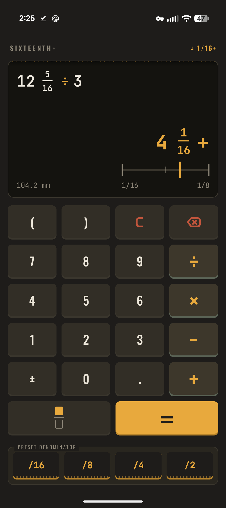

<h1 align="center">Sixteenth+</h1>

<p align="center">
  <strong>A fractional-inch calculator for woodworkers.</strong><br />
  Answers round to the nearest 1/16", with a <code>+</code> when the value sits halfway to the next one.
</p>

<p align="center">
  <a href="https://github.com/lukeadair/sixteenth-plus/releases/latest"></a>
  
  
  
</p>

<p align="center">
  
</p>

Sixteenth+ is an Android shop calculator. Type measurements the way you say them, like
`7 1/4 × 3`, and get an answer in fractions of an inch. Everything stays on the phone.

## What it does

**Fractions in, fractions out.** Mixed numbers and bare fractions, with preset denominator keys (/16, /8, /4, /2).

**Honest rounding.** Answers snap to the nearest 1/16". A `+` means the exact value is halfway to the next 1/16.

**Gauge.** A small ruler shows where the exact answer falls between ticks, plus the value in millimetres.

**Real expressions.** Parentheses, precedence and implicit multiplication, with a cursor to edit anywhere in the expression.

## Install

Download the APK from the [latest release](../../releases/latest) and open it on an Android
8.0+ phone (allow installs from your browser or file manager when asked).

## Build

Needs the JDK bundled with Android Studio:

```sh
export JAVA_HOME="/Applications/Android Studio.app/Contents/jbr/Contents/Home"
./gradlew testDebugUnitTest
./gradlew assembleDebug
```

## Layout

- `app/src/main/java/com/sixteenthplus/calc/CalcEngine.kt`: pure math/state engine (no Android deps)
- `app/src/main/java/com/sixteenthplus/ui/`: Compose UI and palette/fonts
- `app/src/test/…/CalcEngineTest.kt`: engine unit tests
- `third_party/`: OFL licenses for the bundled Oswald and JetBrains Mono fonts

## License

MIT, see [LICENSE](LICENSE). The bundled fonts are under the SIL Open Font License (see `third_party/`).
